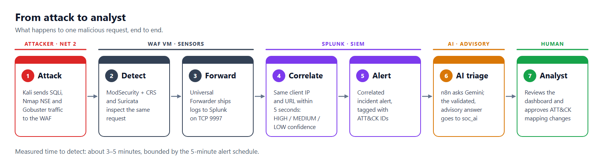
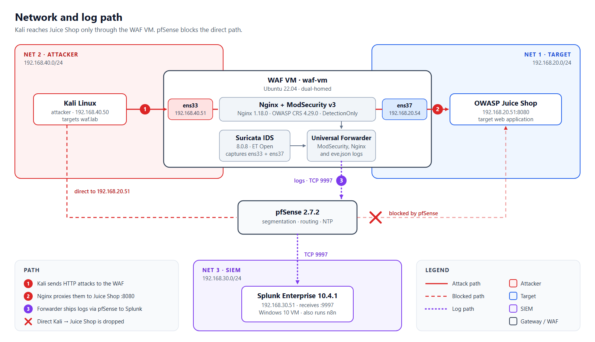
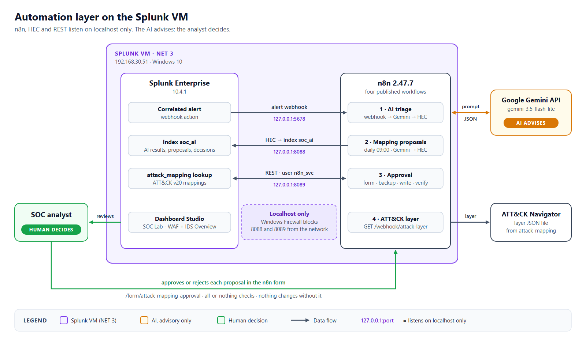
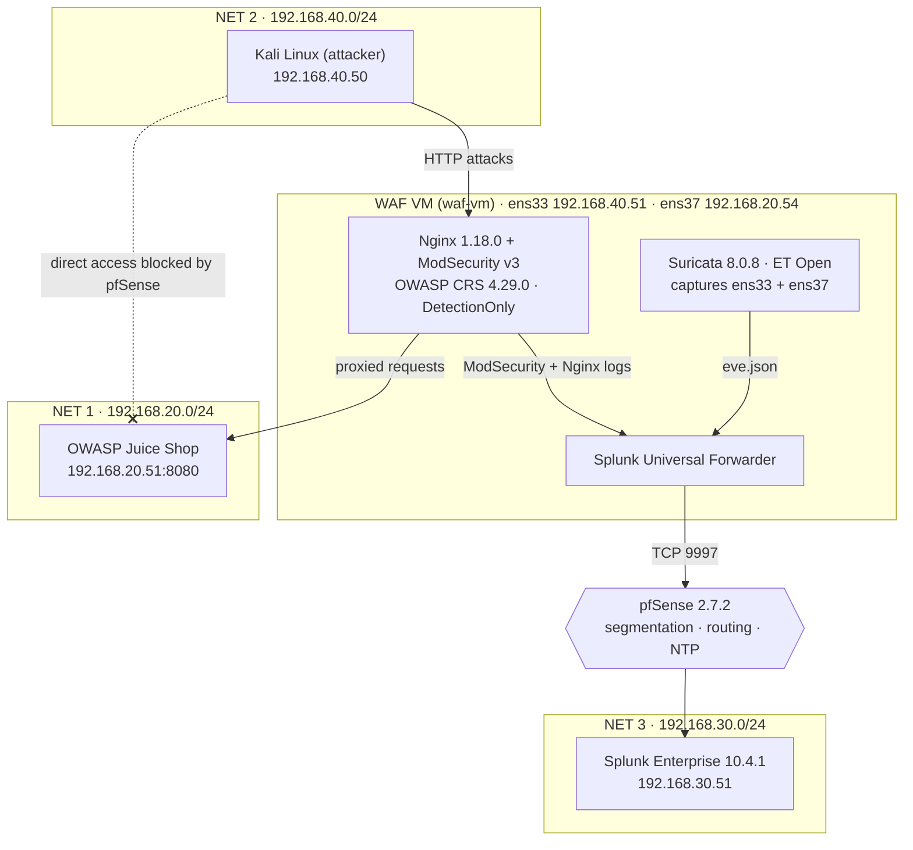
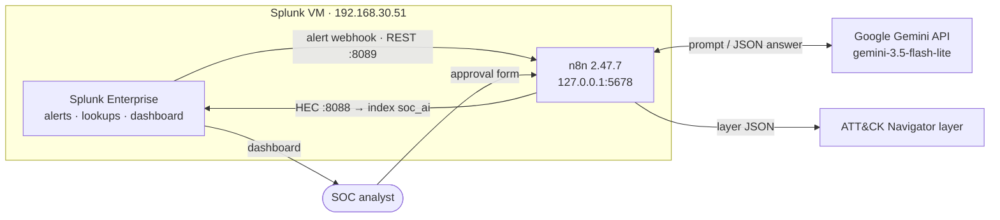
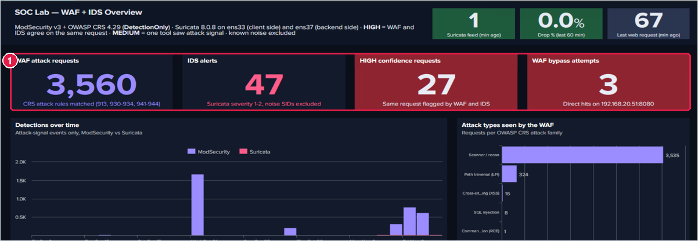
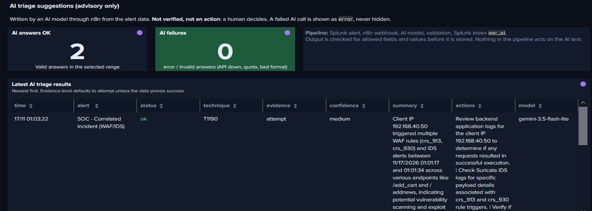
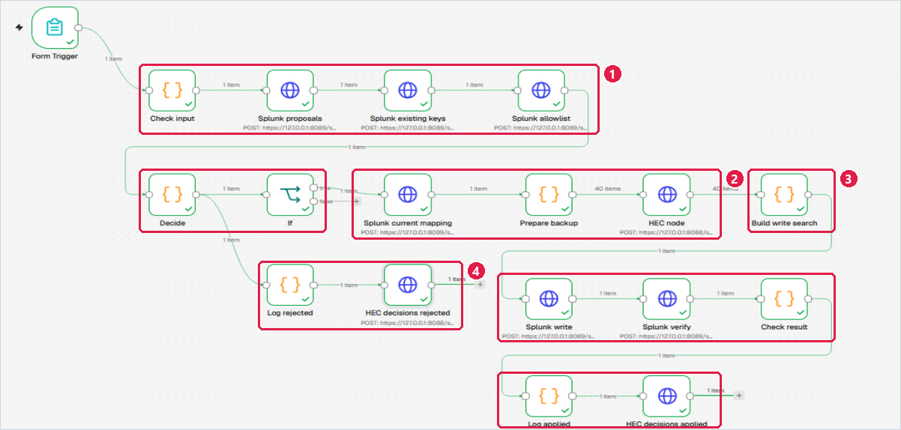
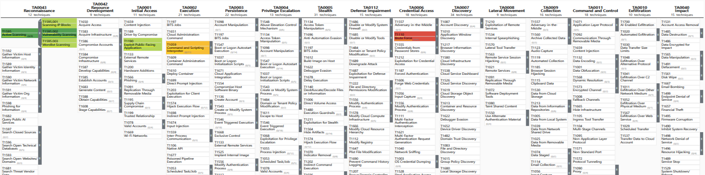

# Intelligent SOC: WAF, SIEM and AI-Assisted Automation

A three-network SOC lab where every attack on a deliberately vulnerable web application (OWASP Juice Shop) passes a WAF and an IDS, lands in Splunk as one correlated incident, and gets an AI-assisted triage. Detections are mapped to MITRE ATT&CK, and a human approves every mapping change before n8n applies it.

## How it works

1. **Attack.** Kali sends SQL injection, Nmap NSE and Gobuster traffic to the WAF. pfSense blocks the direct path to the application.
2. **Detect.** On one dual-homed VM, Nginx with ModSecurity v3 and OWASP CRS 4.29.0 inspects each request, and Suricata 8.0.8 watches the same traffic.
3. **Correlate.** A Splunk Universal Forwarder ships all logs to Splunk Enterprise, which joins WAF and IDS events on client IP and URL within 5 seconds and rates them HIGH, MEDIUM or LOW.
4. **Triage.** The correlated alert calls n8n, which asks Google Gemini for a summary. The validated, advisory-only answer is written back to Splunk.
5. **Decide.** The analyst works from one Dashboard Studio dashboard and approves AI-proposed ATT&CK mappings in a form. n8n applies them with a backup, a verification and a decision log.

## Results at a glance

From the 22 tests in [Tests and results](docs/08-tests-and-results.md):

| Area | Test | Result |
|---|---|---|
| Correlation | T1 · SQL injection, Nmap NSE, Gobuster | Correlated incidents with HIGH/MEDIUM confidence |
| Segmentation | T2 · Kali → 192.168.20.51 directly | Blocked by pfSense; only the WAF path works |
| Detection speed | T5 · attack, then alert | About 3–5 minutes (5-minute schedule) |
| AI triage | T8, T11 · correlated alert, real Gobuster attack | `ai_status=ok`, T1190, evidence `attempt`; AI events on the dashboard |
| AI robustness | T9, T10 · prompt injection, wrong model name | Still `ok`, no PWNED, injection flagged; failure stored as `ai_status=error` (404) |
| ATT&CK proposals | T12, T13 · unmapped SIDs, rerun | 7 valid proposals stored as pending; rerun writes 0 new events |
| Approval and rollback | T14, T15 | Lookup 40 → 42 with backup; rollback 42 → 40, then re-apply → 42 |
| Input validation | T16, T18–T20 · replay, malformed line, unknown SID, already mapped | All stopped; existing rows never overwritten |
| SPL injection | T21 · poisoned proposal | Neutralized: official name used, no `pwned.csv` anywhere |
| Production | T22 · published form and layer webhook | Form loads; layer returns 7 techniques |

## Architecture

**Network and log path.** Kali reaches Juice Shop only through the dual-homed WAF VM, pfSense blocks the direct path, and logs reach Splunk on TCP 9997.

**Automation on the Splunk VM.** n8n and the Splunk HEC and REST ports listen on localhost only. The AI advises; the analyst approves every mapping change.

Editable SVG sources are in [`docs/diagrams/`](docs/diagrams/).

Text version of the diagrams (Mermaid)

## Key capabilities

- Two detection layers on one gateway: ModSecurity + CRS (application) and Suricata with ET Open rules (network).
- pfSense segmentation: the attacker can reach the application only through the WAF.
- Splunk correlation of WAF and IDS events on client IP and URL within 5 seconds, with HIGH / MEDIUM / LOW confidence.
- Detection and health alerts, tagged with ATT&CK technique IDs.
- MITRE ATT&CK v20 mapping in the `attack_mapping` lookup and a generated ATT&CK Navigator layer.
- AI triage: each correlated alert goes to Gemini; the validated, advisory-only answer is written back to Splunk.
- Human-approved ATT&CK mapping: AI proposals, an approval form, backup, verified write, decision log and rollback.
- Dashboard Studio dashboard covering health, detections, correlation, ATT&CK, AI triage and mapping review.

## Technology

| Component | Version |
|---|---|
| Nginx | 1.18.0 (Ubuntu) |
| ModSecurity | v3 with the ModSecurity-nginx connector |
| OWASP CRS | 4.29.0 |
| Suricata | 8.0.8, ET Open rules |
| Splunk Enterprise | 10.4.1 |
| pfSense | 2.7.2 |
| n8n | 2.47.7 (npm, Node.js 24.22.3) |
| AI model | Google Gemini API, free tier, `gemini-3.5-flash-lite` |
| MITRE ATT&CK | Enterprise v20 (collection 20.1) |

## Network

| Network | Subnet | Host | Address | Role |
|---|---|---|---|---|
| NET 2 | 192.168.40.0/24 | Kali Linux | 192.168.40.50 | Attacker (controlled tests) |
| NET 2 / NET 1 | — | WAF VM (Ubuntu 22.04, host `waf-vm`) | ens33 192.168.40.51, ens37 192.168.20.54 | Nginx + ModSecurity v3 + CRS 4.29.0, Suricata 8.0.8, Universal Forwarder |
| NET 1 | 192.168.20.0/24 | OWASP Juice Shop | 192.168.20.51:8080 | Target web application |
| NET 3 | 192.168.30.0/24 | Splunk Enterprise 10.4.1 (Windows 10 VM) | 192.168.30.51 (receiving port 9997) | SIEM, dashboard, lookups; n8n runs on the same VM |
| — | — | pfSense 2.7.2 | gateway of each subnet | Segmentation, routing, NTP source |

## Screenshots

*SOC Lab - WAF + IDS Overview. ① WAF attack requests, IDS alerts, HIGH-confidence requests and WAF bypass attempts.*

*AI triage suggestions. ① The section is advisory only. ② A real result for a correlated incident: `ok`, T1190, evidence `attempt`.*

*Approval workflow: ① checks, ② backup, ③ write and verification, ④ decision logging for rejected and applied lines.*

*Navigator layer generated from the `attack_mapping` lookup. ① The mapped techniques, coloured by coverage status.*

## Documentation

| # | Page | What it covers |
|---|---|---|
| 1 | [Architecture](docs/01-architecture.md) | Networks, hosts, traffic flows and the segmentation test |
| 2 | [WAF: Nginx and ModSecurity](docs/02-waf-modsecurity.md) | Reverse proxy vhost, CRS load order, key ModSecurity settings, logs |
| 3 | [Suricata IDS](docs/03-suricata-ids.md) | Capture interfaces, eve.json output, watchdog and reliability |
| 4 | [Splunk SIEM](docs/04-splunk-siem.md) | Forwarding, indexes, macros, correlation, alerts, dashboard |
| 5 | [MITRE ATT&CK mapping](docs/05-mitre-attack.md) | The `attack_mapping` and technique lookups, Navigator layer |
| 6 | [n8n AI triage](docs/06-n8n-ai-triage.md) | n8n setup, credentials, and the alert → Gemini → Splunk workflow |
| 7 | [n8n ATT&CK mapping](docs/07-n8n-attack-mapping.md) | AI proposals, human approval, backup, rollback, layer |
| 8 | [Tests and results](docs/08-tests-and-results.md) | The 22 tests and the evidence for each |
| 9 | [Troubleshooting](docs/09-troubleshooting.md) | 20 problems met while building the lab, with fixes |
| 10 | [Security considerations](docs/10-security-considerations.md) | Advisory-only AI, injection defences, least privilege, secrets |
| 11 | [Demo runbook](docs/11-demo-runbook.md) | A full demo, from the attack to the Navigator layer |

Other folders: [`scripts/`](scripts/) (ATT&CK lookup and layer generators), [`splunk/`](splunk/) (dashboard JSON and `attack_mapping.csv`).

## Author

Jihad Mohamed Alahiane, cybersecurity engineering student, ENSA Kénitra.

Built for education in an isolated lab. Attack traffic was generated only against lab systems.
