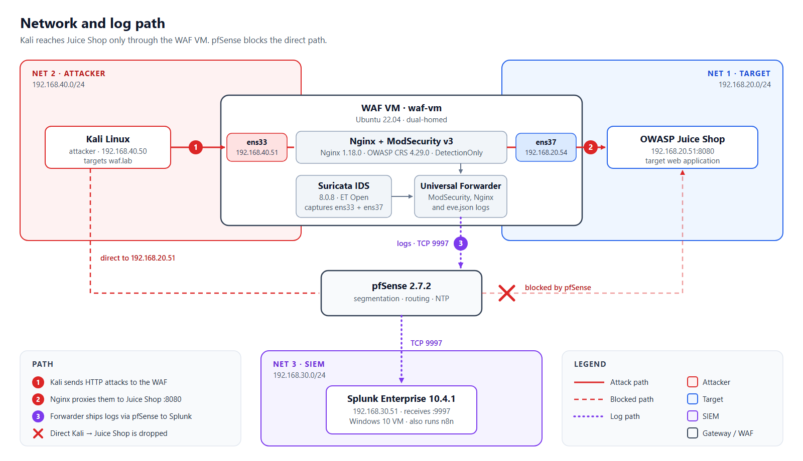
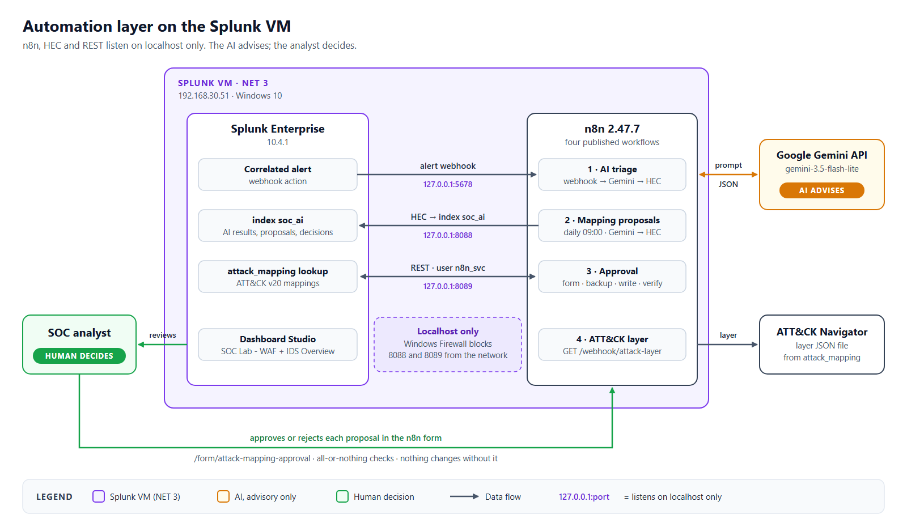
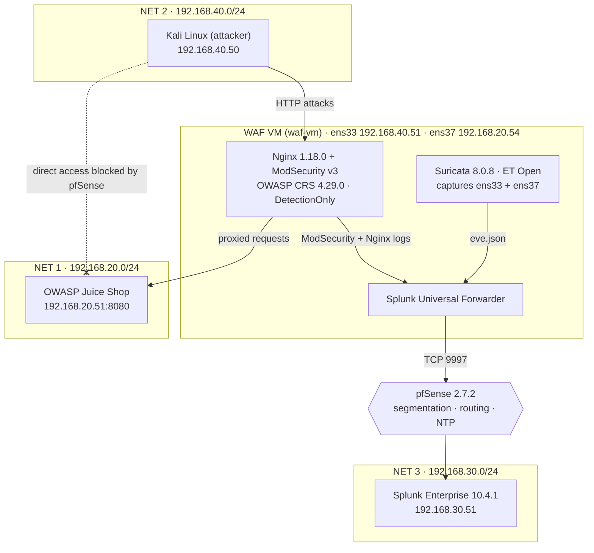
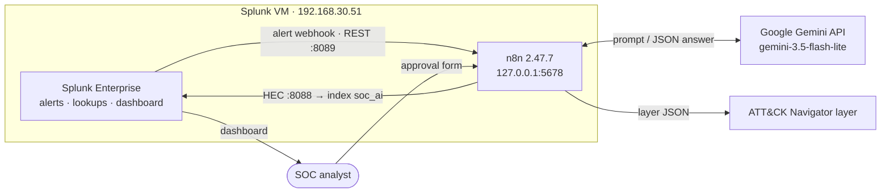
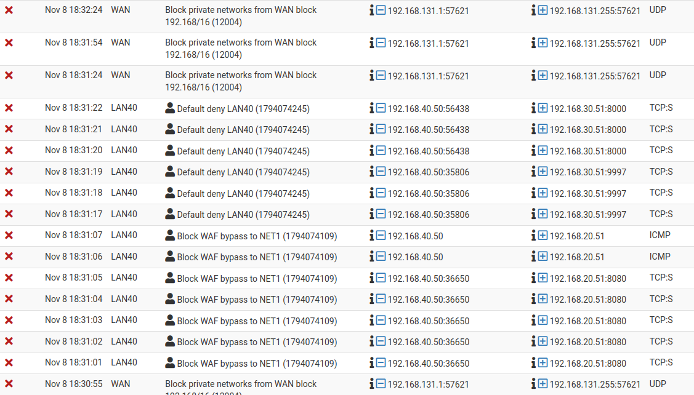
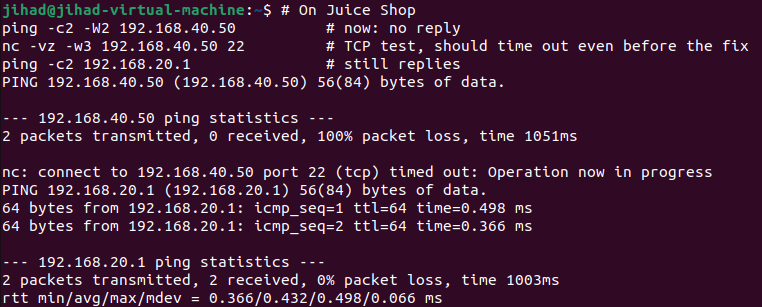
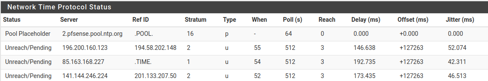

# 1. Architecture

> **Covers:** the three networks, hosts, traffic and log flows, the segmentation test and time sync.  
> **Takeaway:** the attacker can reach the application only through the dual-homed WAF VM; pfSense blocks the direct path.

The lab has three networks joined by pfSense. The attacker sits in NET 2, the target application in NET 1, and the SIEM in NET 3. A dual-homed WAF VM is the only path from NET 2 to NET 1.

## Networks and hosts

| Network | Subnet | Host | Address | Role |
|---|---|---|---|---|
| NET 2 | 192.168.40.0/24 | Kali Linux | 192.168.40.50 | Attacker (controlled tests) |
| NET 2 / NET 1 | — | WAF VM (Ubuntu 22.04, host `waf-vm`) | ens33 192.168.40.51, ens37 192.168.20.54 | Nginx + ModSecurity v3 + CRS 4.29.0, Suricata 8.0.8, Universal Forwarder |
| NET 1 | 192.168.20.0/24 | OWASP Juice Shop | 192.168.20.51:8080 | Target web application |
| NET 3 | 192.168.30.0/24 | Splunk Enterprise 10.4.1 (Windows 10 VM) | 192.168.30.51 (receiving port 9997) | SIEM, dashboard, lookups; n8n runs on the same VM |
| — | — | pfSense 2.7.2 | gateway of each subnet | Segmentation, routing, NTP source |

## Diagram

**Network and log path.** Kali reaches Juice Shop only through the WAF. pfSense blocks the direct path.

**Automation on the Splunk VM.** n8n and the Splunk HEC and REST ports listen on localhost only. The AI is advisory; the analyst approves every mapping change.

Editable SVG sources: [`docs/diagrams/`](diagrams/).

Text version of the diagrams (Mermaid)

## Traffic and data flows

- Kali can only reach the application through the WAF (`http://192.168.40.51`, or `waf.lab` on Kali). pfSense blocks direct access from Kali to 192.168.20.51.
- Nginx proxies to `http://192.168.20.51:8080`. ModSecurity inspects each request. Suricata captures on both ens33 (client side) and ens37 (backend side).
- The Universal Forwarder on the WAF VM sends ModSecurity, Nginx and Suricata logs through pfSense to Splunk on TCP 9997.
- When the correlated alert fires, Splunk calls the n8n webhook on localhost. n8n calls the Gemini API and writes the result to Splunk through the HTTP Event Collector (HEC) on localhost:8088.
- n8n reads Splunk through the REST API on localhost:8089, as user `n8n_svc`.

## Segmentation test

The bypass path was tested in both directions. pfSense logs the blocked attempt, and Kali cannot open the backend directly.

*pfSense blocks Kali when it tries to reach NET 1 directly. ① "Block WAF bypass to NET1" hits from 192.168.40.50 to 192.168.20.51.*

*Direct access from Kali to 192.168.20.51 fails; only the WAF path works. ① 100% packet loss and a TCP timeout.*

## Time synchronisation

pfSense is the NTP source for every VM.

*pfSense NTP status.*
