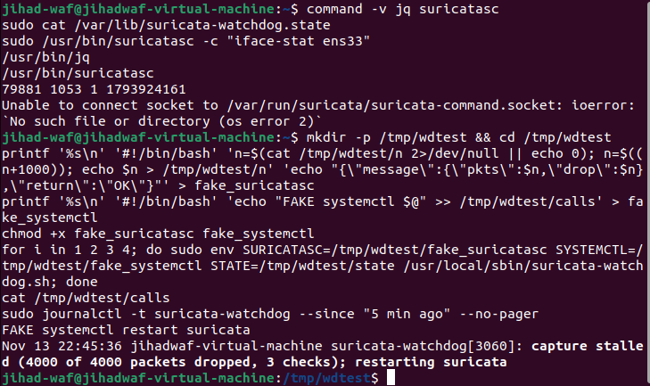

# 3. Suricata IDS

Suricata 8.0.8 runs on the WAF VM with the ET Open rule set. It sees the same traffic as the WAF, on both sides of the proxy.

## Capture and output

- Interfaces: ens33 (client side, NET 2) and ens37 (backend side, NET 1).
- Output: `/var/log/suricata/eve.json`.
- Shipped to Splunk as `index=security sourcetype=suricata:eve host=waf-vm`.

## Reliability

- **Watchdog.** A systemd watchdog timer (`suricata-watchdog`) restarts Suricata when capture stalls.
- **Command socket.** A `tmpfiles.d` rule recreates the Suricata command socket directory at boot. This was verified across a reboot.
- **Log rotation** is configured for Suricata, and disk usage is monitored.
- **Splunk health alerts:** Suricata capture/ingest health, Suricata packet drops, Suricata heartbeat and Suricata watchdog visibility (see [Splunk SIEM](04-splunk-siem.md)).

*The watchdog detects a simulated capture stall and restarts Suricata.*

## Local rules

SIDs 2200000 to 2299999 are local lab rules. They are mapped to ATT&CK by hand and excluded from the AI proposal search (see [n8n ATT&CK mapping](07-n8n-attack-mapping.md)).
