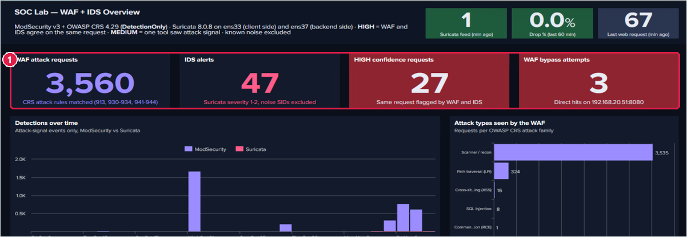
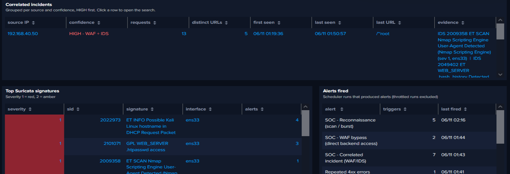
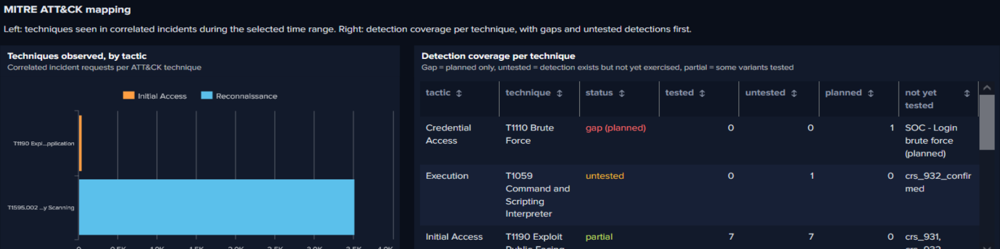
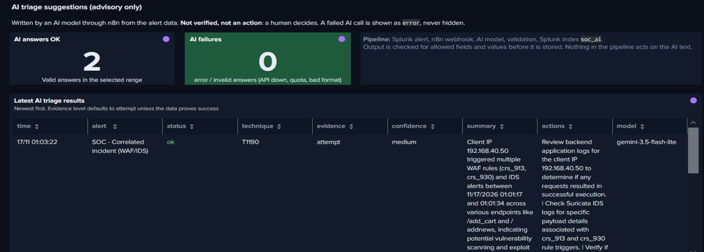
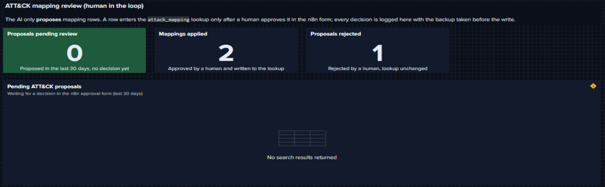
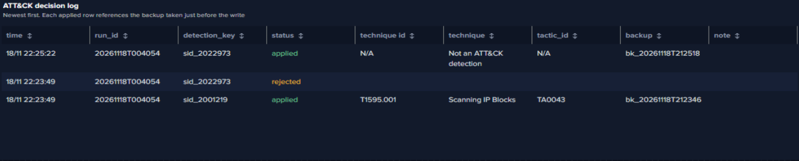

# 4. Splunk SIEM

> **Covers:** log forwarding, indexes, macros, WAF/IDS correlation, alerts and the dashboard.  
> **Takeaway:** WAF and IDS events are joined on client IP and URL within 5 seconds into one incident with HIGH / MEDIUM / LOW confidence.

Splunk Enterprise 10.4.1 runs on a Windows 10 VM at 192.168.30.51. It receives forwarded logs on TCP 9997, correlates WAF and IDS events, runs the alerts and hosts the dashboard.

## Forwarding

Universal Forwarder `inputs.conf` on the WAF VM:

```ini
[monitor:///var/log/modsecurity/audit.log]
index = waf
sourcetype = modsecurity:audit
host = waf-vm

[monitor:///var/log/nginx/waf_access.log]
index = waf
sourcetype = nginx:waf:access
host = waf-vm

[monitor:///var/log/nginx/waf_error.log]
index = waf
sourcetype = nginx:waf:error
host = waf-vm

[monitor:///var/log/suricata/eve.json]
index = security
sourcetype = suricata:eve
host = waf-vm
```

`outputs.conf`:

```ini
server = 192.168.30.51:9997
```

## Indexes and sourcetypes

| Index | Sourcetypes | Content |
|---|---|---|
| `waf` | `modsecurity:audit`, `nginx:waf:access`, `nginx:waf:error` | WAF events |
| `security` | `suricata:eve` | Suricata alerts and stats |
| `soc_ai` | `soc:ai`, `soc:ai:mapping_proposal`, `soc:ai:mapping_backup`, `soc:ai:mapping_decision` | Everything n8n writes |
| `linux`, `main` | — | Pre-existing indexes, not used by these workflows |

## Macros

| Macro | Purpose |
|---|---|
| `waf_audit` | ModSecurity audit events |
| `waf_access` | Nginx WAF access events |
| `corr_incidents` | WAF + IDS correlation |
| `attack_tag` | Tags alerts with ATT&CK technique IDs |

## Correlation

The macro `corr_incidents` joins WAF and Suricata events on client IP and URL within a 5-second window. It assigns a confidence of HIGH, MEDIUM or LOW. It was tested with SQL injection, Nmap NSE and Gobuster runs.

## Alerts

All alerts live in the app `search`. They run every 5 minutes, on staggered schedules, with throttling. `attack_tag` adds the ATT&CK technique IDs.

**Detection**

- SOC - Correlated incident (WAF/IDS)
- Port scan (Suricata)
- Reconnaissance
- Low-and-slow enumeration (100+ distinct paths in 60 minutes, peak under 30 per minute)
- Repeated 4xx
- WAF bypass (direct backend access)

**Health**

- Backend availability (502/503/504 only)
- Suricata capture/ingest health
- Suricata packet drops
- Suricata heartbeat
- Suricata watchdog visibility
- WAF disk usage
- Forwarder silent
- Clock skew / ingestion lag

Measured time to detect is about 3 to 5 minutes, bounded by the 5-minute schedule.

Two alerts also call n8n: "SOC - Correlated incident (WAF/IDS)" and "SOC - WAF bypass (direct backend access)" (see [n8n AI triage](06-n8n-ai-triage.md)).

## Dashboard

"SOC Lab - WAF + IDS Overview" is built in Dashboard Studio. The source is [`splunk/soc_dashboard_studio.json`](../splunk/soc_dashboard_studio.json). Sections:

- health KPIs and WAF/IDS KPIs
- detections timeline and attack families
- correlated incidents table
- top Suricata signatures and fired alerts
- MITRE ATT&CK: techniques observed and coverage per technique
- AI triage suggestions (advisory only): AI answers OK / AI failures KPIs and the latest results table
- ATT&CK mapping review (human in the loop): pending / applied / rejected KPIs, a pending proposals table and the decision log


*Overview: health KPIs, WAF/IDS KPIs and timelines.*


*Correlated incidents table and top Suricata signatures.*


*Techniques observed and coverage per technique.*


*AI triage suggestions with a real result.*


*ATT&CK mapping review: pending, applied and rejected KPIs.*


*Decision log table, each decision linked to its backup ID.*

## Hardening in this phase

- NTP from pfSense to all VMs.
- Operating rule: shut VMs down instead of suspending them, and boot pfSense first.
- X-Forwarded-For spoofing fix on the WAF.
- pfSense rules that block the Kali → Juice Shop bypass. The pass and block tests both passed.
- WAF log rotation and disk monitoring.
