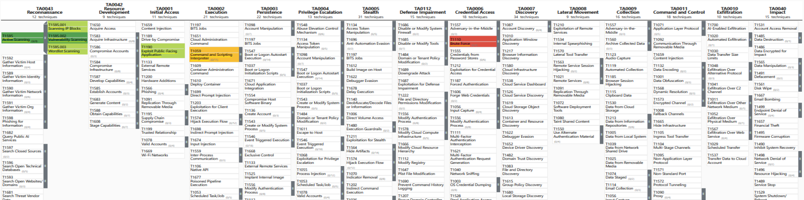
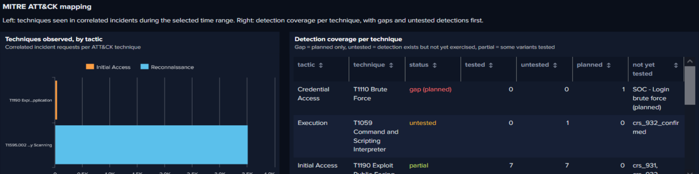

# 5. MITRE ATT&CK mapping

> **Covers:** the `attack_mapping` and `attack_techniques.csv` lookups and the Navigator layer generator.  
> **Takeaway:** every detection maps to an ATT&CK v20 technique (or `N/A`), and the official technique list is the allow-list for all AI output.

Detections are mapped to MITRE ATT&CK Enterprise v20 (collection 20.1). Two lookups hold the data: `attack_mapping` (what the lab detects) and `attack_techniques.csv` (the official technique list).

## Lookup `attack_mapping`

- Shared at app level (`search`).
- Columns: `detection_key, tactic_id, tactic, technique_id, technique, evidence, coverage_status, attack_version`.
- 42 rows: 40 created by hand, plus 2 added through the n8n approval workflow:
  - `sid_2001219` → T1595.001 Scanning IP Blocks
  - `sid_2022973` → not an ATT&CK detection (informational)
- Reference copy: [`splunk/attack_mapping.csv`](../splunk/attack_mapping.csv).

`detection_key` names a saved alert, a correlation signal (`signal_*`), a CRS rule family (`crs_9xx`) or a Suricata signature (`sid_<SID>`). Health and operational alerts are kept in the lookup with `technique_id = N/A`.

## Lookup `attack_techniques.csv`

- The 706 Enterprise ATT&CK techniques of collection 20.1.
- Columns: `technique_id, name, tactic_ids, tactic_names, is_subtechnique`.
- Revoked and deprecated techniques are skipped.
- Built by [`scripts/build_techniques.py`](../scripts/build_techniques.py) from MITRE's `enterprise-attack.json` (attack-stix-data).
- n8n uses it as the allow-list that every technique ID must match.

```bash
python build_techniques.py enterprise-attack.json attack_techniques.csv
```

## Navigator layer

- [`scripts/build_layer.py`](../scripts/build_layer.py) is the original Python generator.
- [`scripts/n8n_build_layer_node.js`](../scripts/n8n_build_layer_node.js) is the same logic inside the n8n "Build layer" Code node. It was proven to produce identical JSON.
- n8n serves the layer on demand (see [n8n ATT&CK mapping](07-n8n-attack-mapping.md#workflow-4-attck-layer)).

```bash
python build_layer.py attack_mapping.csv soc_lab_attack_layer.json
```

Colour per coverage status:

| Status | Colour |
|---|---|
| tested | `#53a051` |
| partial | `#b5d55a` |
| untested | `#f8be34` |


*Navigator layer generated from `attack_mapping`. ① The mapped techniques, coloured by coverage status.*

## On the dashboard


*Techniques observed and coverage per technique.*
