# 6. n8n and AI triage

> **Covers:** the n8n installation, credentials, Splunk access and the AI triage workflow.  
> **Takeaway:** each correlated alert gets a Gemini summary that is validated and stored as advisory only; n8n listens on localhost only.

n8n runs on the Splunk VM. It sends each correlated alert to Google Gemini and writes a validated, advisory-only answer back into Splunk.

## Installation

- n8n 2.47.7, installed with npm, version pinned, on Node.js 24.22.3.
- Data folder: `C:\soc-automation\n8n-data`. Its ACL is limited to the user, SYSTEM and Administrators.
- Start script `C:\soc-automation\start-n8n.bat` sets these variables, then runs `n8n start`:

| Variable | Value |
|---|---|
| `N8N_USER_FOLDER` | `C:\soc-automation\n8n-data` |
| `N8N_LISTEN_ADDRESS` | `127.0.0.1` |
| `N8N_PORT` | `5678` |
| `N8N_DIAGNOSTICS_ENABLED` | `false` |
| `N8N_VERSION_NOTIFICATIONS_ENABLED` | `false` |
| `N8N_TEMPLATES_ENABLED` | `false` |
| `N8N_PERSONALIZATION_ENABLED` | `false` |

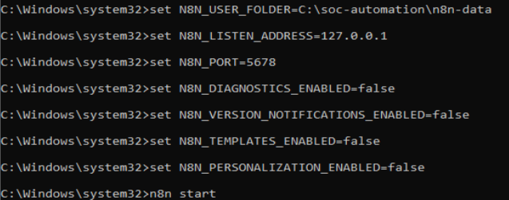
*Environment variables set before `n8n start`.*

- n8n listens on 127.0.0.1:5678 only, verified with `netstat`.

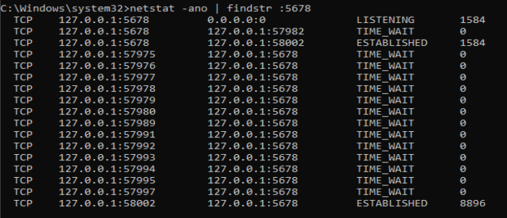
*n8n listens on the loopback address only.*

- Autostart: Task Scheduler task "n8n SOC", at logon, no time limit.

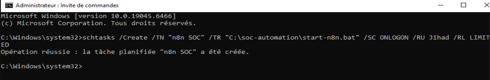
*The "n8n SOC" task starts n8n at logon.*

- n8n 2.x has autosave and **Publish**. Production URLs (`/webhook/...`, `/form/...`) run the published version. Test URLs (`/webhook-test/`, `/form-test/`) only work while the editor is listening.
- All four workflows are Published.

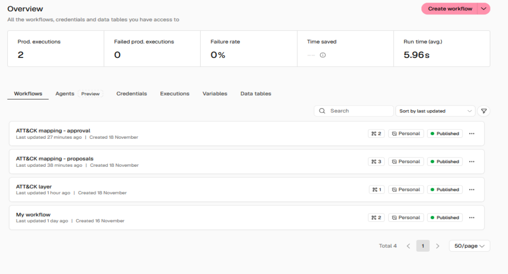
*The four workflows, all Published.*

- The data folder was backed up to `Documents\n8n-data_backup_2026-11-18` (609 files) with n8n stopped.

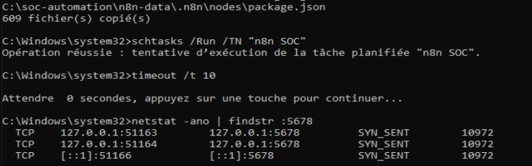
*Backup of 609 files, then restart through the scheduled task.*

## Credentials and Splunk access

Credentials are stored in n8n only. They are referred to here by name.

| Name | Type | Use |
|---|---|---|
| `Gemini key` | Header Auth, header `x-goog-api-key` | Gemini API |
| `Splunk HEC soc_ai` | Header Auth, value format `Splunk <token>` | Splunk HEC |
| Splunk REST user `n8n_svc` | roles `user` + `n8n_svc` | Read access to the needed indexes and lookups, write access to `attack_mapping` |

Splunk side:

- index `soc_ai`
- HEC token `n8n_soc_ai`, indexer acknowledgment off, default index `soc_ai`
- Windows Firewall rules that block 8088 and 8089 from the network (loopback still works)

## Common HTTP calls

Each Splunk REST call is an HTTP Request node:

- `POST https://127.0.0.1:8089/services/search/v2/jobs/export`
- form body: `search`, `output_mode=json`, `earliest_time`, `latest_time`
- the code keeps only final rows (`preview === false`)

Each HEC call is:

- `POST https://127.0.0.1:8088/services/collector/event`
- JSON body `{{ $json.payload }}`, ignore SSL (self-signed, localhost), On Error: Stop Workflow

## Workflow 1: SOC AI triage

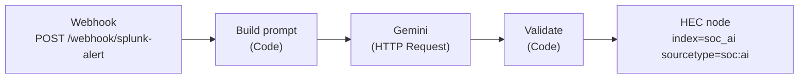

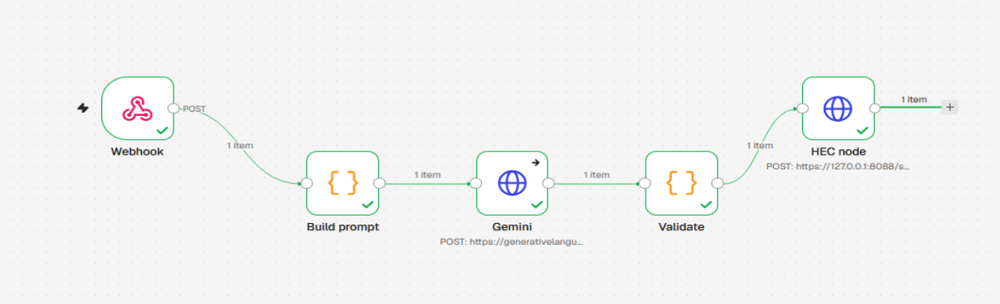
*Webhook → Build prompt → Gemini → Validate → HEC.*

### Trigger

The saved alerts "SOC - Correlated incident (WAF/IDS)" and "SOC - WAF bypass (direct backend access)" have a Webhook action with URL `http://127.0.0.1:5678/webhook/splunk-alert`. Splunk sends the search name, sid, results link and the first result row.

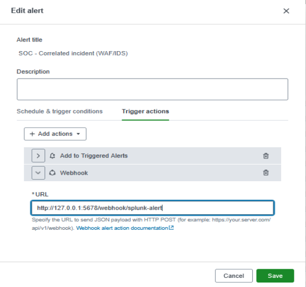
*The correlated alert calls the local n8n webhook.*

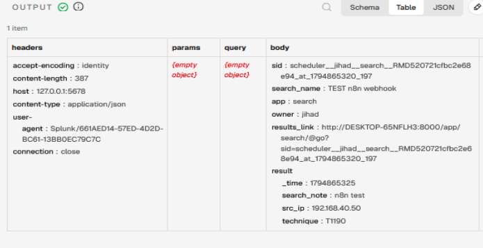
*The webhook payload as received by n8n.*

### Build prompt

- The alert data is wrapped in tags and marked as untrusted. `<` and `>` are stripped.
- A system instruction defines the role and the exact JSON schema.
- The Gemini REST body uses `systemInstruction`, `contents` and `generationConfig.responseMimeType: "application/json"`.

### Gemini

- `POST https://generativelanguage.googleapis.com/v1beta/models/gemini-3.5-flash-lite:generateContent`, with the `Gemini key` credential.
- On Error: continue, so a failure still produces an event.
- The answer is read from `candidates[0].content.parts[0].text`.

### Validate

Parses the JSON and checks every field against allow-lists. Output fields:

| Field | Values |
|---|---|
| `ai_status` | `ok` \| `error` \| `invalid` |
| `ai_error` | error text, if any |
| `ai_model` | model name |
| `summary` | short text |
| `likely_technique` | ATT&CK technique ID |
| `evidence_level` | defaults to `attempt` |
| `confidence` | model confidence |
| `suggested_actions` | list of actions for the analyst |
| `uncertainty` | what the model is unsure about |
| `advisory_only` | always `true` |

### HEC

Writes the result to `index=soc_ai sourcetype=soc:ai`.

## Result

A real Gobuster attack from Kali produced AI events for the correlated alert. They appear on the dashboard.

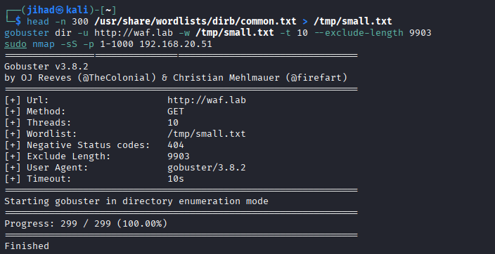
*Gobuster directory enumeration from Kali, through the WAF.*

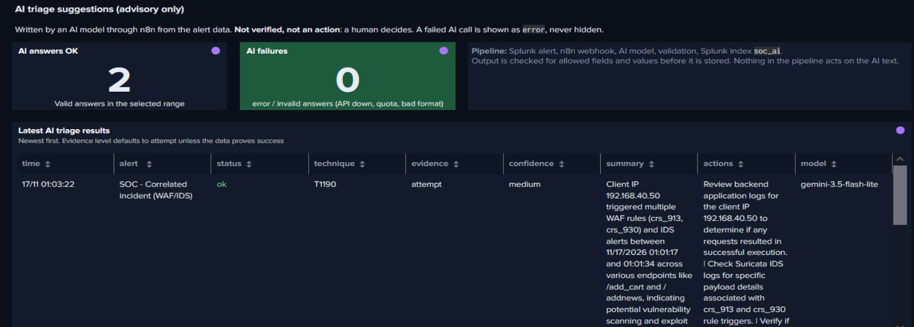
*The AI answer for the correlated incident on the dashboard. ① Advisory-only notice. ② `ok`, T1190, evidence `attempt`.*
