# 7. n8n ATT&CK mapping

> **Covers:** the proposals, approval and layer workflows that maintain the `attack_mapping` lookup.  
> **Takeaway:** the AI only proposes; a human approves, and every write has a backup, a verification, a decision log and a rollback.

Three workflows keep the `attack_mapping` lookup up to date. The AI proposes rows for unmapped Suricata signatures, a human approves them in a form, and n8n applies them with a backup, a verification, a decision log and a rollback search. A fourth workflow turns the lookup into an ATT&CK Navigator layer.

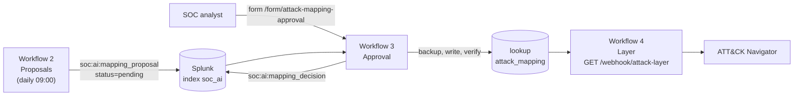

## Workflow 2: proposals

`Manual Trigger` + `Schedule Trigger (daily 09:00)` → `Splunk unmapped SIDs` → `Parse` → `Build prompt` → `Gemini` → `Splunk allowlist` → `Validate proposals` → `To HEC` → `HEC node`

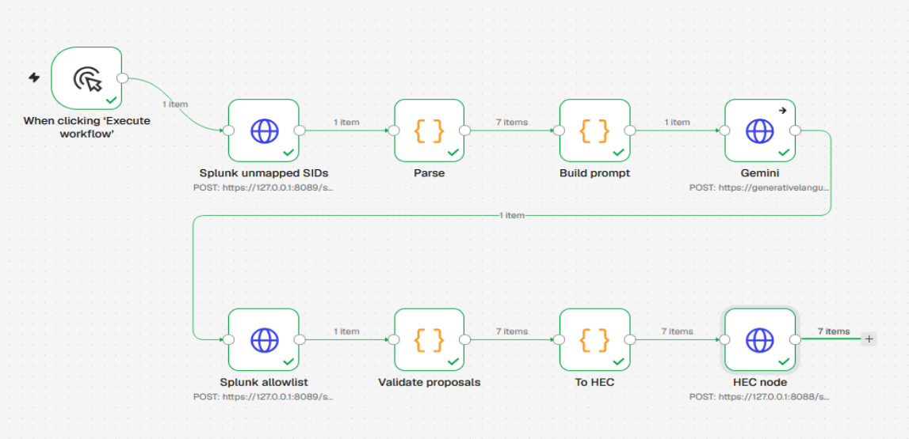
*Proposals workflow, from the unmapped SID search to HEC.*

### Production search

```spl
search index=security sourcetype=suricata:eve host=waf-vm event_type=alert
| eval sid=tonumber('alert.signature_id'), severity=tonumber('alert.severity'), signature='alert.signature', category='alert.category'
| where severity<=2 AND NOT (sid>=2200000 AND sid<2300000)
| eval detection_key="sid_".sid
| lookup attack_mapping detection_key OUTPUT technique_id AS mapped
| where isnull(mapped)
| search NOT [ search index=soc_ai sourcetype=soc:ai:mapping_proposal earliest=-30d | dedup detection_key | fields detection_key ]
| stats count values(signature) as signature values(category) as category max(severity) as severity by detection_key
| sort - count | head 10
```

Time range: `earliest_time=-30d`, `latest_time=now`. SIDs 2200000–2299999 are local lab rules, mapped by hand.

### Steps

- **Parse** keeps the final rows and removes duplicates.

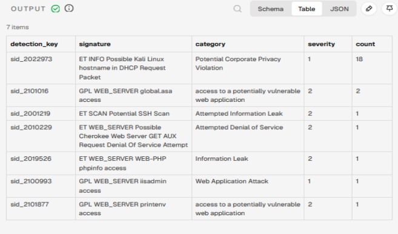
*The search found 7 unmapped SIDs.*

- **Validate proposals:**
  - every `technique_id` must exist in `attack_techniques.csv`
  - tactic and values pass a character allow-list
  - forced values: `evidence=attempt`, `coverage_status=untested`, `attack_version=v20`
- **Output:** one event per proposal in `soc:ai:mapping_proposal` with `status=pending`, `run_id` (format `YYYYMMDDTHHMMSS`), `signature`, `hits_30d`, `reason`, `confidence`, `advisory_only=true`.

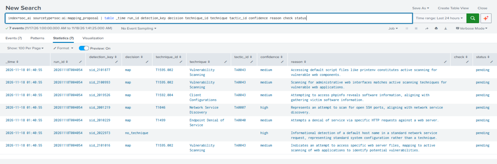
*Pending proposals stored in `index=soc_ai`.*

- **Rerun check:** with every SID mapped or already proposed, a run returns 0 items and writes no event.

## Workflow 3: approval (the human decision)

`Form Trigger (/form/attack-mapping-approval)` → `Check input` → `Splunk proposals` → `Splunk existing keys` → `Splunk allowlist` → `Decide` → `If (ok and rows > 0)` → `Splunk current mapping` → `Prepare backup` → `HEC node` (backup) → `Build write search` → `Splunk write` → `Splunk verify` → `Check result` → `Log applied` → `HEC decisions applied`

From `Decide`, a second branch runs `Log rejected` → `HEC decisions rejected`.

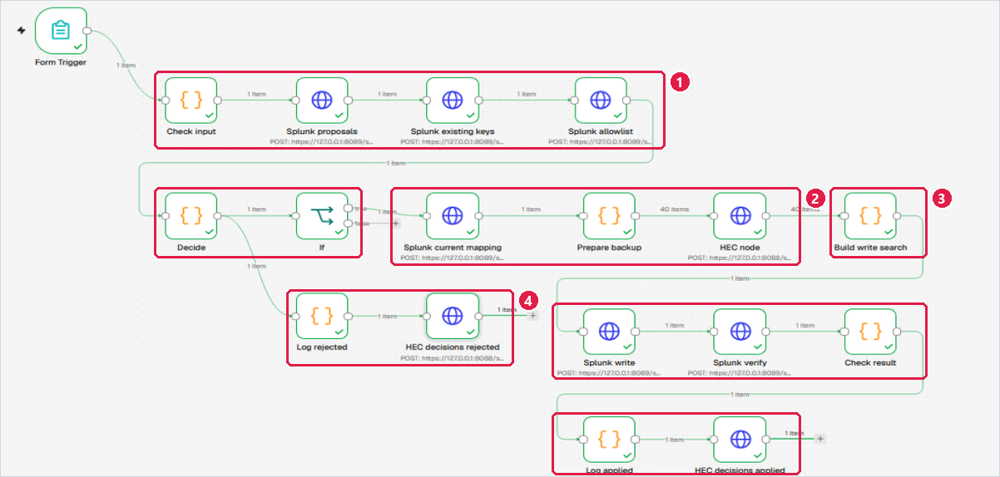
*Approval workflow with the applied and rejected logging branches.*

### The form

| Field | Rule |
|---|---|
| Run ID | strict regex `^\d{8}T\d{6}$` |
| Decisions | one per line: `sid_X approve`, `sid_X reject`, `sid_X noise`, or `sid_X T1595.001` (add a tactic such as `TA0043` if the technique belongs to several) |
| Reviewer note | free text |

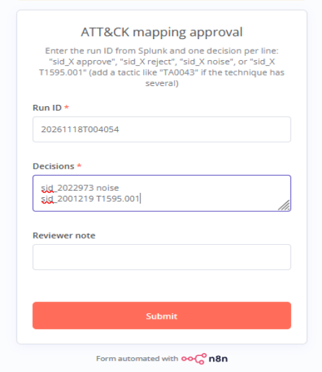
*The approval form: run ID, one decision per line, reviewer note.*

### Checks

1. Input format.
2. The SID must be a pending proposal of that run.
3. Never overwrite an existing key.
4. The technique must exist in ATT&CK v20.
5. Every value placed into SPL must match `^[A-Za-z0-9 .,()\/&'\-:+_]{1,120}$`.
6. All-or-nothing: if any line fails, nothing is written.

The technique name always comes from `attack_techniques.csv`, never from the proposal text.

The `Decide` node returns:

```js
return [{ json: { ok: errors.length === 0, runId: inp.runId, rows: errors.length ? [] : rows, rejected, errors, note: inp.reviewer_note } }];
```

The If node continues only when `ok === true && rows.length > 0`.

### Backup

Every current row is sent to `soc:ai:mapping_backup` with a `backup_id` of the form `bk_YYYYMMDDTHHMMSS` before the write.

### Write search

The column order is pinned with `table`:

```spl
| inputlookup attack_mapping
| append [| makeresults | eval detection_key="…", tactic_id="…", … | fields - _time]
| dedup detection_key
| table detection_key tactic_id tactic technique_id technique evidence coverage_status attack_version
| outputlookup attack_mapping.csv
```

### Verify

The row count is checked after the write. `Check result` returns `ok`, `total`, `added`, `backupId` and the exact rollback search.

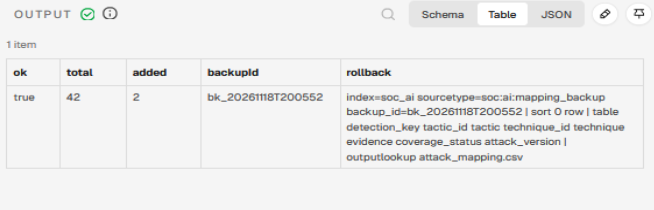
*First apply: total 42, added 2, with the backup ID.*

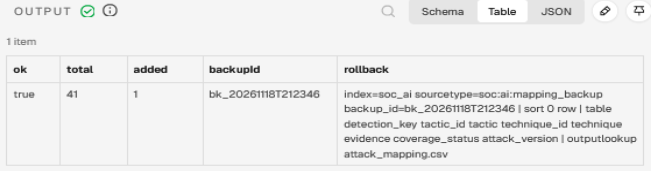
*Check result shows the backup ID and the rollback search.*

### Rollback

```spl
index=soc_ai sourcetype=soc:ai:mapping_backup backup_id=<id>
| sort 0 row
| table detection_key tactic_id tactic technique_id technique evidence coverage_status attack_version
| outputlookup attack_mapping.csv
```

### Decision logging

Both branches write to `soc:ai:mapping_decision`:

```js
// Log rejected (after Decide)
const d = $input.first().json;
if (!d.ok || !d.rejected.length) return [];
return d.rejected.map(k => ({ json: { payload: { index: "soc_ai", sourcetype: "soc:ai:mapping_decision", source: "n8n",
  event: { run_id: d.runId, detection_key: k, status: "rejected", note: d.note || "" } } } }));

// Log applied (after Check result)
const d = $('Decide').first().json;
const c = $input.first().json;
return d.rows.map(r => ({ json: { payload: { index: "soc_ai", sourcetype: "soc:ai:mapping_decision", source: "n8n",
  event: { run_id: d.runId, detection_key: r.detection_key, status: "applied", technique_id: r.technique_id,
    technique: r.technique, tactic_id: r.tactic_id, backup_id: c.backupId, note: d.note || "" } } } }));
```

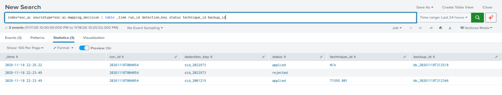
*Applied and rejected decisions in Splunk, with backup IDs.*

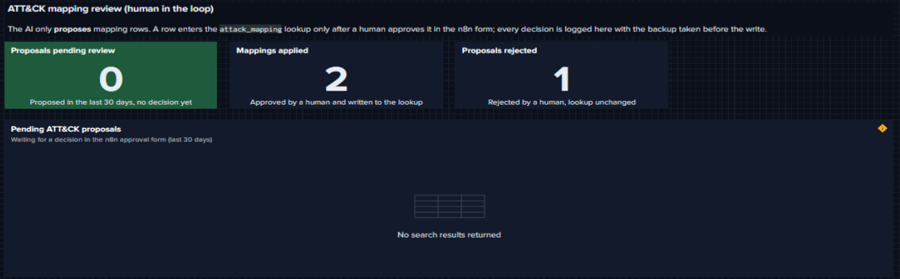
*Mapping review KPIs on the dashboard.*

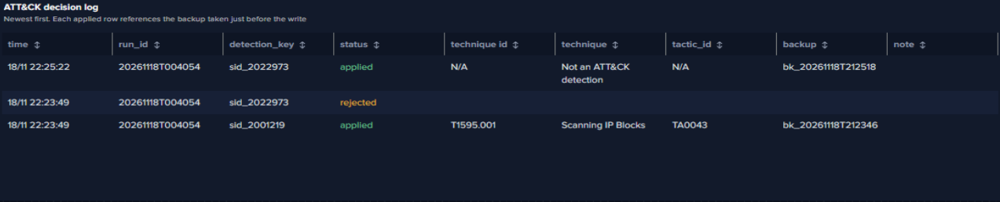
*Decision log table on the dashboard.*

## Workflow 4: ATT&CK layer

`Webhook (GET /webhook/attack-layer)` → `Splunk mapping` (reads the lookup) → `Build layer` (Code, [`scripts/n8n_build_layer_node.js`](../scripts/n8n_build_layer_node.js)) → `Respond to Webhook` (JSON, header `Content-Disposition: attachment; filename="soc_lab_attack_layer.json"`)

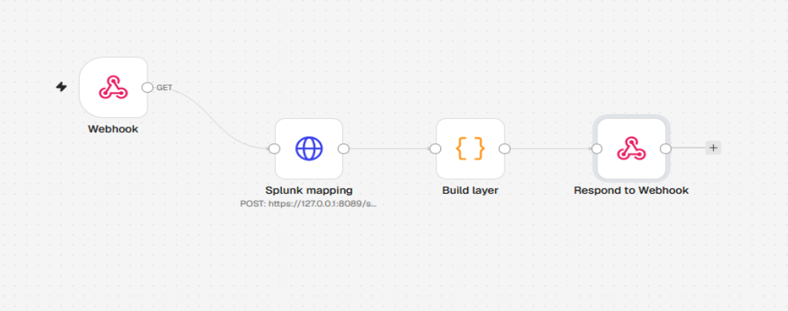
*Layer workflow: read the lookup, build the layer, return it as a file.*

The production URL returned a layer with 7 techniques: the lookup holds 8 distinct `technique_id` values, and `N/A` is excluded. Open the file in ATT&CK Navigator.

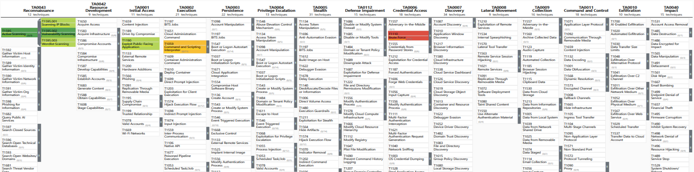
*The generated layer in ATT&CK Navigator.*
