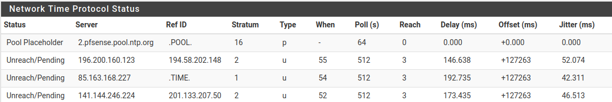
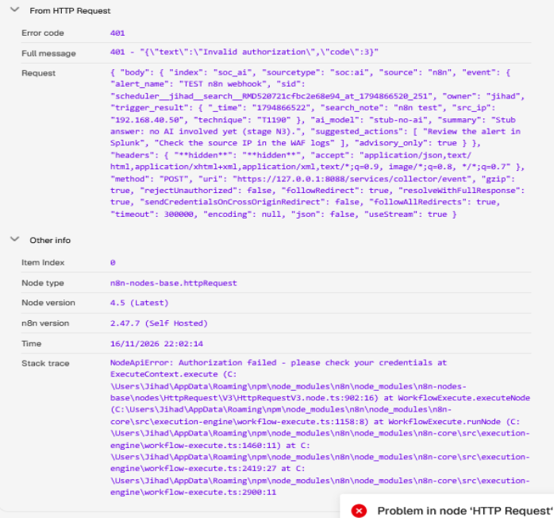
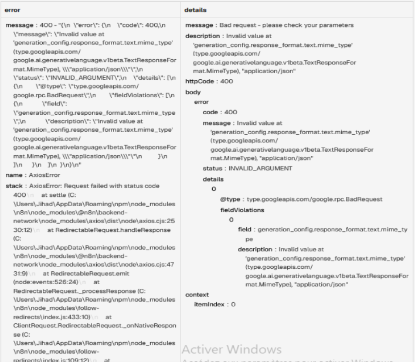

# 9. Troubleshooting

Problems met while building the lab, in the order they were found.

### 1. Suricata watchdog blind

- **Symptom:** no restarts despite stalls.
- **Cause:** the Suricata command socket directory was missing after boot.
- **Fix:** a `tmpfiles.d` rule that recreates it, verified across a reboot, plus a "watchdog visibility" alert.

### 2. Clock skew after suspend and resume

- **Symptom:** clock skew between VMs.
- **Cause:** pfSense came back with a stale clock and the VMs followed it.
- **Fix:** NTP from pfSense to all VMs, shut down instead of suspending, boot pfSense first, and a clock-skew alert.

*pfSense serves NTP to every VM.*

### 3. X-Forwarded-For spoofing

- **Symptom:** a client could set its own X-Forwarded-For header.
- **Fix:** the WAF no longer trusts a client-supplied header.

### 4. Backend availability alert matched 4xx

- **Symptom:** the alert matched 4xx instead of 5xx.
- **Fix:** recreated it for 502/503/504 only.

### 5. Splunk refused searches and paused indexing

- **Symptom:** "minimum free disk space (5000MB) reached". The forwarder-silent and heartbeat alerts fired as side effects.
- **Cause:** low free space on the Windows drive.
- **Fix:** cleaned the drive (old installer, npm cache, DISM component cleanup), from about 3.9 GB to about 7.5 GB free.

### 6. HEC 401 `Invalid authorization` (code 3)

- **Symptom:** n8n got HTTP 401 from HEC.
- **Cause:** wrong Header Auth value.
- **Fix:** the Header Auth value must be `Splunk <token>`.

*The 401 error returned by HEC before the fix.*

### 7. HEC "Data channel is missing" (code 10)

- **Cause:** indexer acknowledgment was on for the token.
- **Fix:** turn indexer acknowledgment off on the token.

### 8. Gemini 400 invalid `response_format` enum

- **Fix:** use `generationConfig.responseMimeType: "application/json"`.

*The 400 error returned by Gemini before the fix.*

### 9. Model choice

- **Cause:** a Claude Pro subscription does not include API access.
- **Fix:** the lab uses the Gemini API free tier. Only lab data is sent.

### 10. n8n 2.x has no Active toggle

- **Fix:** use Publish (Shift+P). Production URLs run only the published version. "Published, has changes" means a newer draft is not live.

### 11. Splunk Enterprise webhook allow-list

- **Fix:** it is configured in `alert_actions.conf`, not in the UI.

### 12. Task Scheduler start failed (last result 1)

- **Cause:** `start-n8n.bat` was missing.
- **Fix:** recreated it, then removed the 72-hour execution limit and the battery conditions.

### 13. `n8n_svc` saw an empty lookup

- **Cause:** the lookup ACL granted the role, but the user did not hold that role.
- **Fix:** assign role `n8n_svc` to the user, and share the lookup and definition at app level.

### 14. Export endpoint duplicates

- **Cause:** the JSON export streams `preview:true` rows before the final rows.
- **Fix:** keep only `preview === false`. Do not switch to `output_mode=csv`: it hides errors.

### 15. Lookup columns became alphabetical after `outputlookup`

- **Fix:** pin the column order with `table` in the write search and the rollback search.

### 16. The approval workflow continued after validation errors

- **Fix:** an If node (`ok === true && rows.length > 0`). `Decide` returns empty rows on any error.

### 17. "Error in 'stats' command" with two searches in one search box

- **Cause:** Splunk parses them as one search.
- **Fix:** run them separately.

### 18. `dir` with a wildcard in the folder path fails in cmd

- **Fix:** use PowerShell `Get-ChildItem -Recurse`.

### 19. Nmap from Kali reports 192.168.20.51 as down

- **Cause:** expected. NET 2 cannot reach NET 1 directly.
- **Fix:** target the WAF.

### 20. Form or webhook "not listening"

- **Cause:** the `-test` URLs only work while the editor listens.
- **Fix:** use `/form/...` and `/webhook/...` after publishing.
