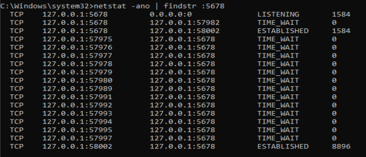

# 10. Security considerations

> **Covers:** the security controls around the AI, the local services and the secrets.  
> **Takeaway:** the AI never acts on its own, n8n, HEC and REST are reachable from localhost only, and no secret is stored in this repository.

- **Advisory-only AI.** No workflow takes an automatic response action. Every mapping change requires a human decision.
- **Prompt-injection defences.** Untrusted data is wrapped in tags and stripped of `<>`. Output is validated against allow-lists. SPL values pass a character allow-list. Technique names come from the official ATT&CK list. Tests T9 and T21 in [Tests and results](08-tests-and-results.md) cover this.
- **Least privilege.** n8n reads Splunk as `n8n_svc` with only the needed indexes and lookups, and has write access only to `attack_mapping`.
- **Local-only services.** n8n listens on 127.0.0.1. Splunk HEC (8088) and REST (8089) are blocked from the network by the Windows Firewall.
- **Secrets.** Secrets live only in n8n credentials and a password manager, never in workflows, documents or Git. This repository names them only: the HEC token `n8n_soc_ai`, the n8n credentials `Gemini key` and `Splunk HEC soc_ai`, and the Splunk user `n8n_svc`.
- **Integrity.** Every mapping write has a backup, a verification, a decision log and a tested rollback.
- **Data sent to the AI.** Only lab alert data is sent. The free tier may use prompts for training outside the EU/UK/EEA.
- **Network.** pfSense segmentation forces all attack traffic through the WAF.

*n8n listens on the loopback address only.*
