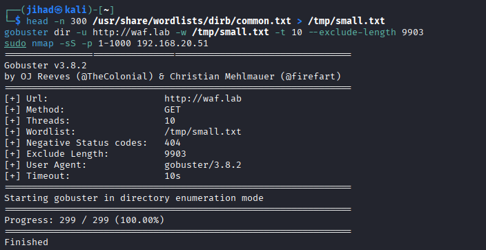

# 11. Demo runbook

A full demo, from the attack to the Navigator layer.

## 1. Pre-flight

- Boot pfSense first and check that the clocks agree.
- Check that the Splunk drive has more than 5 GB free.
- Check that n8n listens on loopback only:

  ```bat
  netstat -ano | findstr :5678
  ```

  Expected: `127.0.0.1:5678 LISTENING`.
- Check the lookup size. Expected: 42.

  ```spl
  | inputlookup attack_mapping | stats count
  ```

- Check that all three sourcetypes arrive:

  ```spl
  index=waf OR index=security earliest=-5m | stats count by sourcetype
  ```

## 2. Attack from Kali, against the WAF only

```bash
nmap -sV -T4 192.168.40.51
gobuster dir -u http://192.168.40.51 -w /usr/share/wordlists/dirb/common.txt
```

Then send SQLi and XSS `curl` requests to `/rest/products/search?q=...`.


*Gobuster through the WAF.*

## 3. Splunk

Show the dashboard, the raw ModSecurity and Suricata events, and the correlated incidents table.

## 4. Alert

Check **Activity > Triggered Alerts**, then n8n **Executions**. The triage run appears automatically.

## 5. AI result

```spl
index=soc_ai sourcetype=soc:ai | sort 0 - _time | head 3
```

Then show the AI triage section of the dashboard.

## 6. Proposals and approval

1. Run the proposals workflow.
2. Approve in `http://localhost:5678/form/attack-mapping-approval`.
3. Show the backup, the count and the decision log.

## 7. Layer

```bat
curl.exe -s http://localhost:5678/webhook/attack-layer -o layer.json
```

Open `layer.json` in ATT&CK Navigator.
